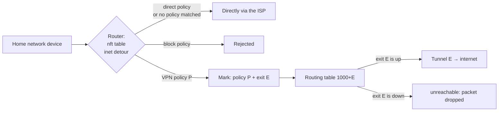

# Detour for OpenWrt

**English** | [Русский](README.ru.md)

Policy-based routing for a home OpenWrt router: which traffic goes through a VPN, which goes directly, and which is blocked. Failover between several VPN exits and a kernel-level kill-switch: traffic meant for the VPN never leaves outside the tunnel.


Detour ships as regular OpenWrt packages (`apk`) plus a section in the LuCI web interface (**Services → Detour**). It is written in ucode, OpenWrt's built-in scripting language, so the packages are architecture-independent (`noarch`) and need no compilation.

## Contents

- [Features](#features)
- [How it works](#how-it-works)
- [Requirements](#requirements)
- [Installation](#installation)
- [Configuration](#configuration)
- [Command line](#command-line)
- [Architecture](#architecture)
- [Building from source](#building-from-source)
- [Testing](#testing)
- [Troubleshooting](#troubleshooting)
- [Notes on Xiaomi BE7000](#notes-on-xiaomi-be7000)
- [Limitations](#limitations)
- [License](#license)

## Features

**Policies**
- Three kinds of policies: through VPN exits, **direct** (never through a tunnel) and **block**.
- What a policy matches: addresses and subnets, domains with subdomains, devices (by MAC), ports, large lists.
- Policies are checked in order; the first match wins.
- A VPN policy has an ordered list of exits: the first working one carries the traffic, with failover to the next and back.
- Kill-switch: when none of a policy's exits works, its traffic is blocked. A policy can optionally be allowed to go directly instead.
- Manual pinning of an exit to a policy.

**Exits**
- WireGuard, AmneziaWG (including obfuscation) and VLESS, VMess, Trojan, Shadowsocks, Hysteria2, TUIC proxies on the **sing-box** or **Xray** engine (XHTTP and VLESS encryption are Xray-only).
- Add from anything: share links, base64 lists, `wireguard://`, Amnezia `vpn://` keys, `.conf` files, sing-box/Xray JSON, Clash/Mihomo YAML.
- VPN provider subscriptions: automatic or manual server choice, traffic and expiry info, custom User-Agent and HWID.
- Chains: an exit that connects to its server through another exit (`via`).
- One-click Cloudflare WARP: registration, AmneziaWG obfuscation, moving away from bad Cloudflare points of presence.
- Export an exit as a link, a `.conf` file and a QR code; speed test; "why doesn't it work" diagnostics.

**Lists**
- Ready-made [v2fly](https://github.com/v2fly/domain-list-community) and [runetfreedom](https://github.com/runetfreedom/russia-blocked-geosite) categories, any URL or file.
- A searchable category catalogue with entry counts and memory cost.
- Nightly updates; on failure the previous data is kept.
- Memory limits: all lists together take at most 35 % of RAM, and at least 15 % of RAM (64 MB minimum) stays free after loading. A list that does not fit is not loaded, and LuCI shows why.

**Tools**
- **Site check:** where an address goes and why (which rule won, which also matched and lost), and whether it opens directly and through an exit.
- **Devices:** home network devices, how they are connected, today's traffic, and where each device's internet goes.
- A device's **DNS log**: which names it looks up, with "through VPN", "directly" and "block" buttons.
- **Traffic:** per device and per exit, through the VPN and directly, for a day, 3, 7 and 30 days, and 12 months.

**Other**
- The router's own DNS: through a tunnel with an encrypted fallback (DoH/DoT/DoQ), or always encrypted.
- Telegram notifications (9 event types) in English or Russian, queued while the API is unreachable.
- Other programs' traffic can be left out of every policy (`bypass_user`).
- Encrypted settings backup with a restore preview and rollback.
- LuCI login protection with two-factor authentication (`luci-plugin-2fa`).
- English and Russian interface.

## How it works



1. **Classification.** Each new flow from the home network is checked in the nftables table `inet detour`: exceptions first (local addresses, the tunnels' own traffic), then the policies in order.
2. **Mark.** A VPN policy marks the flow (fwmark) with the policy number and its current exit number. The mark is stored in conntrack for the whole connection.
3. **Route.** Each exit has its own routing table (`1000 + exit number`) with a fallback `unreachable` route. If the exit's device disappears, the kernel drops the packet — the kill-switch works even when the daemon is not running.
4. **Domains.** dnsmasq puts the answers for a policy's domains into nft sets (`nftset`). Devices' DNS queries are redirected to the router, and DoT/DoQ to other servers is blocked.
5. **IPv6.** Only IPv4 goes through tunnels. For VPN policy domains the router returns no IPv6 addresses, and IPv6 to a policy's addresses and devices is rejected, so traffic cannot leak directly over IPv6.

**Exit failover.** The `detourd` daemon checks exits with a real request (`https://1.1.1.1/cdn-cgi/trace`). An exit that is down, has just started, or sends without getting answers is checked every `probe_period` seconds (2 by default). A working idle exit is checked every `probe_idle` seconds (30 by default), and one carrying traffic and getting answers once a minute. After `fails` consecutive failures (2 by default) the exit is considered down, policies move to the next exit, and connections through the old exit are reset.

**Resilience.**
- Routing rules come up early at boot (the `detour-fw` service, before dnsmasq), without the daemon.
- Rules are reloaded in place, without deleting the table: there is no window for a leak.
- Domain and list sets are saved and restored across reboots.
- procd restarts a crashed daemon; a cron watchdog restarts a hung one.
- An invalid configuration item is dropped and shown in LuCI while the rest keeps working. If the ruleset fails to load as a whole, the last working one stays.

## Requirements

- **OpenWrt 25.12 or a snapshot** with the `apk` package manager. `opkg`-based releases (24.10 and older) are not supported.
- `nftables` (fw4), and `dnsmasq-full` instead of the stock `dnsmasq`.
- Free space: about 1 MB for Detour and LuCI; the sing-box and Xray engines take 10–30 MB each ([extroot](https://openwrt.org/docs/guide-user/additional-software/extroot_configuration) helps when space is short).

| Package | Needed | For |
|---|---|---|
| `detour` | always | Routing, daemon, command line. |
| `luci-app-detour` | for the web interface | LuCI pages. |
| `sing-box` | for proxy exits and subscriptions | Proxy engine. |
| `xray-core` | for Xray exits | Second engine (XHTTP, Xray configs, `vpn://` keys). |
| `kmod-amneziawg`, `amneziawg-tools` | for AmneziaWG and WARP obfuscation | Kernel module and tools. |
| `dnsproxy` | only for encrypted DNS | DoH/DoT/DoQ resolver. DNS through the tunnel works on dnsmasq alone; dnsproxy only encrypts its fallback while the exits are down. |
| `ucode-mod-zlib` | for `vpn://` keys | Key decompression. |
| `qrencode` | for QR codes | QR code in "Share". |
| `tcpdump-mini` | for the DNS log | Capturing a device's DNS queries. |
| `luci-plugin-2fa` | optional | Two-factor LuCI login. |

If your firmware's repositories lack `xray-core` or `dnsproxy`, they can be built from this repository: the packages contain the official release binaries for `aarch64_cortex-a73`, verified by checksum.

## Installation

### Quick install

On the router, over SSH:

```sh
wget -qO- https://b1ays.github.io/detour/install.sh | sh
```

The script adds the Detour feed and its signing key, replaces `dnsmasq` with `dnsmasq-full` (for the swap the router asks the provider's DNS servers directly, since it has no DNS of its own while dnsmasq is away) and installs `detour` and `luci-app-detour`. Run it again to upgrade. `DETOUR_NO_LUCI=1` installs without the web interface.

### By hand

```sh
wget -O /etc/apk/keys/detour.pem https://b1ays.github.io/detour/detour.pem
echo https://b1ays.github.io/detour/packages.adb >> /etc/apk/repositories.d/customfeeds.list
apk update
apk del dnsmasq && apk add dnsmasq-full    # skip if dnsmasq-full is installed
apk add detour luci-app-detour
```

While `dnsmasq` is removed the router cannot resolve names: if `apk add dnsmasq-full` fails, point `/tmp/resolv.conf` at your provider's DNS servers for the swap (as the install script does).

Every release is also on the [releases page](../../releases): the packages, the index and the key, for installing without the feed.

### Upgrade

Upgrade **only by naming the packages**, otherwise `apk upgrade` also upgrades every system package:

```sh
apk upgrade detour luci-app-detour
```

On install and upgrade the package scripts set up cron jobs, reload the rules in place and restart the daemon. Removal (`apk del detour luci-app-detour`) takes away the table, rules and routes.

## Configuration

### Web interface

**Services → Detour**:

| Page | What it has |
|---|---|
| **Overview** | VPN switch, external address directly and through the exits, speed graph, state of policies and exits, exit pinning, event log, configuration errors. |
| **Policies** | Policies in check order: what they match and where it goes. |
| **Devices** | Home network devices, where their internet goes, DNS log. |
| **Lists** | Large lists, ready-made categories and the catalogue. |
| **Exits** | Exits and subscriptions: check, speed, export, editing. |
| **Add exit** | An exit from a link, key or file; WARP registration. |
| **Settings** | Check frequency, router DNS, Telegram, logs. |
| **Site check** | Where an address goes and why, whether it opens. |
| **Traffic** | Statistics per device and per exit. |
| **Backup** | Saving and restoring Detour's settings. |
| **Components** | The packages Detour uses (sing-box, Xray, AmneziaWG, dnsproxy ...): install, update, remove - only these, never the rest of the firmware. Where a page needs one that is missing, it offers to install it. |

Access is split into two ACL groups: `luci-app-detour` grants only viewing the state (Overview), `luci-app-detour-admin` grants the settings (including keys and tokens), the DNS log, backups and every action.

### `/etc/config/detour`

LuCI usually edits it, but the format is plain UCI:

```
config main 'main'
	option enabled '1'            # master switch: 0 = everything goes directly
	option lan_dev 'br-lan'       # home network device
	option probe_period '2'       # check of an exit that is down, seconds
	option probe_idle '30'        # check of a working idle exit, seconds
	option fails '2'              # this many failures in a row = exit down
	option probe_timeout '8'      # wait for a check's answer, seconds (2..30)
	option alert_hold '10'        # "exit not responding" is sent if it lasts this long, seconds
	option lists_mem_max '300'    # memory cap for all lists, MB (default 35 % of RAM)
	option lists_mem_reserve '150' # memory kept free after loading lists, MB (default 15 % of RAM, at least 64)
	option dns 'tunnel'           # router DNS: off | tunnel | encrypted
	option dns_policy 'vpn'       # policy carrying the router's DNS (tunnel mode)
	option fw_mask '0x00ffff00'   # packet mark bits (policy + exit); change when pbr or mwan3 uses them
	list bypass_user 'myapp'      # system users whose traffic no policy takes (other packages add their own)

# WireGuard exit: the tunnel itself is in /etc/config/network (interface wg_pl)
config exit 'pl'
	option id '1'                 # 1..250, unique; part of the packet mark
	option iface 'wg_pl'
	option label 'Poland'
	option probe 'https://1.1.1.1/cdn-cgi/trace'   # URL or IP to check

# proxy exit: an engine and an exit sharing one device
config engine 'vl_eng'
	option type 'singbox'         # singbox | xray
	option device 'vltun'
	option outbound '/etc/detour/engines/vl.json'
	option via 'pl'               # optional: connect to the server through exit pl
config exit 'vl'
	option id '2'
	option device 'vltun'
	option label 'VLESS'
	option probe 'https://1.1.1.1/cdn-cgi/trace'

config policy 'direct'            # "Directly": never through a tunnel
	option id '3'
	option action 'direct'
	option label 'Directly'
	list domain 'example.org'

config policy 'vpn'
	option id '1'
	option label 'VPN'
	list exit 'pl'                # in order: pl first, vl if it fails
	list exit 'vl'
	list domain 'youtube.com'     # with subdomains
	list dst '91.108.4.0/22'      # addresses and subnets
	list device 'aa:bb:cc:dd:ee:ff'   # all traffic of a device
	list src '192.168.1.50'       # a device by its address (or a subnet; behind another router)
	list network 'guest'          # all devices of a network of the router
	list port 'udp/443'           # 443 = TCP and UDP; tcp/6000-6100 = a range
	option on_down 'direct'       # when every exit is down: directly (default: block)
	option ipv6_block '1'         # refuse all IPv6 of the network from this policy on (IPv6 is not tunnelled)

config policy 'block'             # "Block"
	option id '4'
	option action 'block'
	option label 'Block'
	list domain 'ads.example.com' # answered "no such name"

config list 'yt'
	option policy 'vpn'
	list url 'v2fly:youtube'      # a v2fly category, a URL, or several (address lists: IPv4 and IPv6)
	option label 'YouTube'
	option min_lines '10'         # fewer entries = the update failed

config subscription 'prov'
	option url 'https://…'        # a secret: never logged
	option interval '12'          # hours; default: as the provider advises, else 24
	option via 'pl'               # optional

config notify 'notify'
	option enabled '1'
	option tg_token '…'
	option tg_chat '123456'
	list event 'exit_down'        # exit_down exit_up switch all_down boot wan list_fail sub_fail sub_expire
```

A direct policy placed first works as "always direct"; placed below a VPN policy it is only an exception for what that policy did not take. A policy left without a single valid exit stays in force and blocks its traffic.

## Command line

```sh
detour status                     # state: exits, policies, events (JSON)
detour reload                     # re-read the settings
detour check                      # validate the settings without applying
detour render                     # show the nft table that would be built
detour pin <policy> <exit>        # pin an exit
detour unpin <policy>             # unpin

detour exit-parse <file>          # what a link / key / config holds (no secrets)
detour exit-add <file> <0,2|-> <name> [via|-] [label]
detour exit-export <exit>         # link or .conf and a QR code
detour exit-set-via <exit> <other|->
detour exit-info
detour exit-remove <exit>
detour exit-pick <exit> <key|->   # subscription server (- = automatic)

detour sub-update [name]          # update a subscription (all without a name)
detour lists-update [name]        # update lists
detour lists-mem                  # list memory (JSON)
detour warp-register <name> [awg=1]
detour warp-pick <name>
detour warp-unregister <name>

detour backup <file> <password file>
detour restore <file> <password file> [--apply]

detour fw-start | fw-stop
detour purge                      # remove every trace of Detour from nft, ip rule, routes
```

The daemon is also available over ubus: `ubus call detour status`.

## Architecture

### Repository layout

```
├─ packages/
│  ├─ detour/              core: routing, daemon, command line
│  ├─ luci-app-detour/     web interface, access rights, translation
│  ├─ xray-core/           Xray for firmware without it in the repositories
│  └─ dnsproxy/            dnsproxy for firmware without it in the repositories
├─ tools/                  feed build, translation, category catalogue, the release page
├─ tests/
│  ├─ lab/                 acceptance tests (run on a test router)
│  └─ stub/                stubs of external services
├─ .github/workflows/      checks on every push, releases by tag
└─ install.sh              the quick install script
```

`packages/<name>/root/` holds the files exactly as they land on the router; `control` has the package name, version and dependencies; `scripts/` the install and removal scripts.

### Components on the router

| Component | Purpose |
|---|---|
| `/etc/init.d/detour-fw` | Early start: the `inet detour` table, `ip rule`, routing tables. |
| `/etc/init.d/detour` | The `detourd` daemon, sing-box/Xray engines, `dnsproxy`. |
| `/usr/sbin/detourd` | Daemon: exit checks, exit choice, events, notifications, the `detour` ubus object. Long actions run in the background without stopping the checks. |
| `/usr/sbin/detour` | Command line. |
| `/usr/libexec/detour/` | `fw` (routing only), `lists-update`, `sub-update`, `site-explain`, `watchdog`, `warp-i1`. |
| `/usr/share/ucode/detour/` | ucode modules: settings (`core`), nft table (`nft`), routes (`net`), DNS (`dns`), engines (`engines`), links (`links`), WireGuard (`wgconf`), subscriptions (`subs`), WARP (`warp`, `warppick`), lists and memory (`listmem`), devices, traffic, site check, backups, notifications, login protection. |

Cron jobs: the daemon watchdog every 2 minutes, list updates nightly, subscription updates hourly (each on its own schedule).

### Data storage

| Path | Contents | Survives reboot |
|---|---|---|
| `/etc/config/detour` | All settings (UCI). | yes, and sysupgrade |
| `/etc/detour/` | Proxy exit configs, WARP registrations, list snapshots, traffic history, the settings saved before a restore. | yes, and sysupgrade |
| `/tmp/detour/` | Live state, list data, generated engine configs, notification queue. | no |

Secrets (keys, passwords, the bot token, subscription URLs) are stored in files with mode 600 and never appear on process command lines, in the log or on LuCI pages.

### Marks and tables

```
packet mark        0x00EEPP00    EE = exit number, PP = policy number (main.fw_mask moves them)
ct mark            the same          a flow is classified once; PP = 0xff: "decided: directly"
0x10000000                       the tunnels' own traffic (never classified)
routing table      detour_<exit>    in rt_tables, numbered after the last table in use
ip rule priority   free ones from 11001, a rule per exit looking up its table
```

Only Detour's own rules and tables (by the `detour_` names) are ever changed or removed.

## Building from source

Linux or WSL is required; the OpenWrt SDK is not.

```sh
sh tools/build-feed.sh
```

The result is in `feed/`: the signed index `packages.adb`, the `*.apk` packages and the public key `detour-dev.pem`. The private signing key is kept outside the repository (its path is set by the `KEY` variable) and is created on the first build. `PKGS="detour luci-app-detour"` builds only those packages.

- A package's version comes from its `control` (`version=0.1.0-rN`).
- The build first runs `tools/check-ui.sh` on the LuCI pages: a page gets its data by name (`pdata.all({ status: … })` from `detour/load.js`), never by position (`data[1]`, `Promise.all`), and its syntax is checked where node is installed.
- `xray-core` and `dnsproxy` download the official release of the version in `control` at build time and verify its SHA-256. Archives are cached in `build/`; binaries are not stored in git.
- Translations are built from `po/*/*.po`, which needs `po2lmo` (built once by `tools/build-po2lmo.sh`).
- The geo category catalogue is rebuilt with `python tools/geo-catalog.py packages/luci-app-detour/root/www/luci-static/resources/detour/geo-catalog.json`.

### Releases

GitHub Actions checks every push (`.github/workflows/ci.yml`: shell and JavaScript syntax, translations in sync, a test build). A tag `v<version>` publishes a release (`release.yml`): the packages get that version (`v0.2.0` → `0.2.0-r1`), are signed with the release key, the feed with `install.sh` and a page goes to GitHub Pages, the same files to a GitHub release.

Once per repository:

1. A release key (keep the private one safe, it signs everything routers install):
   ```sh
   openssl ecparam -name prime256v1 -genkey -noout -out detour-release.key
   ```
2. **Settings → Secrets and variables → Actions → New repository secret**: `APK_SIGNING_KEY`, the contents of `detour-release.key`.
3. **Settings → Pages → Source: GitHub Actions**.

A mirror of the feed on your own server (optional): every release also goes there by rsync over SSH, with its own
`install.sh` and page naming the mirror; the packages, the index and the key are the same. In **Settings → Secrets
and variables → Actions**:
- variables `MIRROR_URL` (the address routers use, `https://feed.example.org/detour`), `MIRROR_TARGET`
  (`deploy@feed.example.org:.` with `rrsync`, below; without it the full path,
  `deploy@feed.example.org:/var/www/detour`), `MIRROR_PORT` if SSH is not on 22;
- secrets `MIRROR_SSH_KEY` (a private key of its own: `ssh-keygen -t ed25519 -N "" -f detour-mirror`) and
  `MIRROR_KNOWN_HOSTS` (the output of `ssh-keyscan -p PORT feed.example.org`, compared with the server's
  fingerprint).

The server needs `rsync` and plain static HTTPS for that directory; the directory holds the feed only - every
release deletes there what the feed does not have. The packages go up first, then the index, the old packages are
removed last: a router never gets an index naming a package not there yet.

A user that can only rsync into that directory (Debian/Ubuntu; `rrsync` comes with rsync: `/usr/bin/rrsync`, or
the `rsync-rrsync` package, or `rpm -ql rsync | grep rrsync`):

```sh
useradd --system --create-home --shell /bin/sh deploy
install -d -o deploy -g deploy -m 755 /var/www/detour
install -d -o deploy -g deploy -m 700 /home/deploy/.ssh
```

`/home/deploy/.ssh/authorized_keys` (owner `deploy`, mode 600), one line with `detour-mirror.pub`:

```
restrict,command="/usr/bin/rrsync /var/www/detour" ssh-ed25519 AAAA... detour-mirror
```

`restrict` takes away the terminal and forwarding, `command=` turns whatever the client asks for into rsync locked
in `/var/www/detour` - paths count from there, hence `MIRROR_TARGET` ending in `:.`. With SELinux (CentOS, Rocky,
Alma) fix the labels afterwards, or sshd does not read the key: `restorecon -Rv /home/deploy/.ssh /var/www/detour`.

A release:

```sh
git tag v0.2.0 && git push origin v0.2.0
```

### Interface translation

Interface strings and the texts of the notifications are written in English inside `_('…')`; the Russian translation is a dictionary in `tools/i18n-ru.py`:

```sh
python tools/i18n-ru.py packages/luci-app-detour
```

The command generates `po/ru/detour.po` for LuCI and `packages/detour/root/usr/share/detour/i18n/ru.json` for the notifications, and fails if any string is left untranslated. The language of the notifications is set in **Settings → Telegram notifications** (by default, the language of LuCI).

## Testing

Acceptance tests are shell scripts in `tests/lab/` that run on a test OpenWrt router (for example a QEMU virtual machine) with a client in the home network and test exit servers. External services are replaced by the stubs in `tests/stub/`:

```sh
python -m http.server 8765               # from the repository root: feed and tests for the test router
python -I tests/stub/tg_stub.py 8766     # Telegram Bot API
python -I tests/stub/warp_stub.py 8767   # WARP API
python -I tests/stub/sub_stub.py 8768    # subscription provider
```

On the test router:

```sh
lab tests/lab/t2-routing.sh   # one test
lab tests/lab/all.sh          # the whole suite
```

Each test prints `ok …` or `FAIL …` and ends with `RESULT: PASS|FAIL`. The suite covers routing and the kill-switch, DNS, engines and links, WARP, subscriptions, lists and memory limits, all kinds of policies, backups, LuCI actions and access rights, traffic accounting, devices, installation and removal.

## Troubleshooting

```sh
detour status | less                          # what the daemon thinks
logread -e detour | tail -50                  # log
nft list table inet detour                    # rules
ip rule | grep 110                            # table selection rules
ip route show table 1001                      # route of exit #1
ubus call detour exit_check '{"name":"pl"}'   # a real request through an exit
cat /tmp/detour/engines.err                   # engine errors
```

| Symptom | What to check |
|---|---|
| A site in a policy does not open | Whether the exit works ("Check" on the Exits page). If every exit of the policy is down, that is the kill-switch. |
| A site goes directly although it should go through the VPN | The device uses DNS bypassing the router (DoH in the browser): turn it off or add the site's addresses. Site check helps. |
| A proxy exit does not come up | `cat /tmp/detour/engines.err`, `sing-box check -c /tmp/detour/engines/<name>.json`. |
| A subscription does not update | Its card on the Exits page or `cat /tmp/detour/subs/<name>.status`. |
| No notifications | Settings → test message; `notify_queued` in `detour status`. |
| Configuration errors | Overview or `detour check`. |

## Notes on Xiaomi BE7000

- OpenWrt builds for the BE7000 with the `apk` package manager are supported.
- Hardware flow offloading (PPE) has not been tested. With software offloading, connections that fall under new rules are reset so they cannot bypass the tunnel.

## Limitations

- Only IPv4 goes through tunnels; IPv6 for policy traffic is rejected.
- No schedules, ad blocking or remote access to the home network through the VPN.
- Devices' encrypted DNS (DoH) bypasses domain rules; DoT/DoQ is blocked.

## License

The `detour` and `luci-app-detour` packages are released under the [MIT license](LICENSE). The `xray-core` (MPL-2.0) and `dnsproxy` (Apache-2.0) packages contain third-party software under their own licenses.
