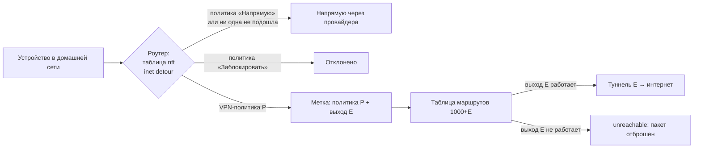

# Detour для OpenWrt

[English](README.md) | **Русский**

Маршрутизация по политикам для домашнего роутера на OpenWrt: какой трафик идёт через VPN, какой напрямую, а какой блокируется. Отказоустойчивость между несколькими VPN-выходами и kill-switch на уровне ядра: трафик, который должен идти через VPN, никогда не уходит мимо туннеля.


Detour — это обычные пакеты OpenWrt (`apk`) и раздел в веб-интерфейсе LuCI (**Службы → Detour**). Код написан на ucode, встроенном языке OpenWrt, поэтому пакеты не зависят от архитектуры (`noarch`) и не требуют компиляции.

## Содержание

- [Возможности](#возможности)
- [Как это работает](#как-это-работает)
- [Требования](#требования)
- [Установка](#установка)
- [Настройка](#настройка)
- [Командная строка](#командная-строка)
- [Архитектура](#архитектура)
- [Сборка из исходников](#сборка-из-исходников)
- [Тестирование](#тестирование)
- [Диагностика](#диагностика)
- [Заметки о Xiaomi BE7000](#заметки-о-xiaomi-be7000)
- [Ограничения](#ограничения)
- [Лицензия](#лицензия)

## Возможности

**Политики**
- Три вида политик: через VPN-выходы, **напрямую** (никогда через туннель) и **заблокировать**.
- Что попадает под политику: адреса и подсети, домены с поддоменами, устройства (по MAC), порты, большие списки.
- Политики проверяются по порядку, первая подошедшая решает.
- У VPN-политики упорядоченный список выходов: работает первый живой, при сбое — переключение на следующий и возврат обратно.
- Kill-switch: если у политики не работает ни один выход, её трафик блокируется. По желанию для отдельной политики можно разрешить уходить напрямую.
- Ручное закрепление выхода за политикой.

**Выходы**
- WireGuard, AmneziaWG (в том числе маскировка) и прокси VLESS, VMess, Trojan, Shadowsocks, Hysteria2, TUIC на движках **sing-box** или **Xray** (XHTTP и шифрование VLESS — только Xray).
- Добавление из чего угодно: ссылки, base64-списки, `wireguard://`, ключи Amnezia `vpn://`, конфиги `.conf`, JSON sing-box/Xray, YAML Clash/Mihomo.
- Подписки VPN-провайдеров: автовыбор рабочего сервера или ручной выбор, данные о трафике и сроке, свои User-Agent и HWID.
- Цепочки: выход, подключающийся к серверу через другой выход (`via`).
- Cloudflare WARP одной кнопкой: регистрация, маскировка AmneziaWG, уход с плохих точек Cloudflare.
- Экспорт выхода ссылкой, файлом `.conf` и QR-кодом; тест скорости; диагностика «почему не работает».

**Списки**
- Готовые категории [v2fly](https://github.com/v2fly/domain-list-community) и [runetfreedom](https://github.com/runetfreedom/russia-blocked-geosite), любые URL и файлы.
- Каталог категорий с поиском, числом записей и ценой в памяти.
- Ночное обновление; при сбое остаются прежние данные.
- Лимиты памяти: все списки вместе не больше 35 % ОЗУ, после загрузки свободно не меньше 15 % ОЗУ (минимум 64 МБ). Список, который не помещается, не загружается, причина видна в LuCI.

**Инструменты**
- **Проверка сайта:** куда пойдёт адрес и почему (какое правило сработало, какие совпали, но проиграли), открывается ли он напрямую и через выход.
- **Устройства:** устройства домашней сети, способ подключения, трафик за день, выбор, куда идёт интернет каждого устройства.
- **Журнал DNS** устройства: какие имена оно запрашивает, с кнопками «через VPN», «напрямую», «заблокировать».
- **Трафик:** по устройствам и выходам, через VPN и напрямую, за день, 3, 7 и 30 дней и 12 месяцев.

**Прочее**
- DNS самого роутера: через туннель с шифрованным резервом (DoH/DoT/DoQ) или всегда шифрованный.
- Уведомления в Telegram (9 видов событий) на русском или английском, с очередью на случай, если API недоступен.
- Трафик других программ можно вывести из-под всех политик (`bypass_user`).
- Зашифрованная резервная копия настроек с предпросмотром восстановления и откатом.
- Защита входа в LuCI при двухфакторной аутентификации (`luci-plugin-2fa`).
- Интерфейс на русском и английском.

## Как это работает



1. **Классификация.** Новый поток из домашней сети проверяется в таблице nftables `inet detour`: сначала исключения (локальные адреса, собственный трафик туннелей), затем политики по порядку.
2. **Метка.** VPN-политика ставит потоку метку (fwmark): номер политики и номер её текущего выхода. Метка запоминается в conntrack для всего соединения.
3. **Маршрут.** У каждого выхода своя таблица маршрутов (`1000 + номер выхода`) с запасным маршрутом `unreachable`. Если устройство выхода пропало, пакет отбрасывается ядром — kill-switch работает, даже когда демон не запущен.
4. **Домены.** dnsmasq кладёт ответы на запросы доменов политики в наборы nft (`nftset`). DNS-запросы устройств перехватываются на роутер, DoT/DoQ к чужим серверам блокируется.
5. **IPv6.** Через туннели идёт только IPv4. Для доменов VPN-политик роутер не отдаёт IPv6-адреса, а IPv6 к адресам и устройствам политики отклоняется, чтобы трафик не ушёл напрямую.

**Переключение выходов.** Демон `detourd` проверяет выходы настоящим запросом (`https://1.1.1.1/cdn-cgi/trace`). Неработающий, только что запущенный или отправляющий без ответов выход проверяется каждые `probe_period` секунд (по умолчанию 2). Работающий выход без трафика — раз в `probe_idle` секунд (по умолчанию 30), с трафиком и ответами — раз в минуту. После `fails` неудач подряд (по умолчанию 2) выход считается упавшим, политики переходят на следующий, соединения через старый выход сбрасываются.

**Надёжность.**
- Правила маршрутизации поднимаются рано при загрузке (служба `detour-fw`, до dnsmasq), ещё без демона.
- Правила перезагружаются на месте, без удаления таблицы: нет окна для утечки.
- Наборы доменов и списков сохраняются и восстанавливаются после перезагрузки.
- Упавший демон перезапускает procd, зависший — сторож из cron.
- Ошибочный элемент настроек отбрасывается и показывается в LuCI, остальное продолжает работать. Если правила не загружаются целиком, остаются последние рабочие.

## Требования

- **OpenWrt 25.12 или snapshot** с менеджером пакетов `apk`. Версии с `opkg` (24.10 и старше) не поддерживаются.
- `nftables` (fw4), `dnsmasq-full` вместо стандартного `dnsmasq`.
- Свободное место: около 1 МБ для Detour и LuCI; движки sing-box и Xray — по 10–30 МБ каждый (при нехватке места помогает [extroot](https://openwrt.org/docs/guide-user/additional-software/extroot_configuration)).

| Пакет | Нужен | Для чего |
|---|---|---|
| `detour` | всегда | Маршрутизация, демон, командная строка. |
| `luci-app-detour` | для веб-интерфейса | Страницы в LuCI. |
| `sing-box` | для прокси-выходов и подписок | Движок прокси. |
| `xray-core` | для выходов на Xray | Второй движок (XHTTP, конфиги Xray, ключи `vpn://`). |
| `kmod-amneziawg`, `amneziawg-tools` | для AmneziaWG и маскировки WARP | Модуль ядра и утилиты. |
| `dnsproxy` | только для шифрованного DNS | Резолвер DoH/DoT/DoQ. DNS через туннель работает на одном dnsmasq; dnsproxy лишь шифрует его запасной вариант, пока выходы не работают. |
| `ucode-mod-zlib` | для ключей `vpn://` | Распаковка ключа. |
| `qrencode` | для QR-кодов | QR-код в «Поделиться». |
| `tcpdump-mini` | для журнала DNS | Запись DNS-запросов устройства. |
| `luci-plugin-2fa` | по желанию | Двухфакторный вход в LuCI. |

Если в репозиториях прошивки нет `xray-core` или `dnsproxy`, их можно собрать из этого репозитория: пакеты содержат официальные бинарники релизов для `aarch64_cortex-a73` с проверкой контрольных сумм.

## Установка

### Быстрая установка

На роутере, по SSH:

```sh
wget -qO- https://b1ays.github.io/detour/install.sh | sh
```

Скрипт добавляет фид Detour и его ключ подписи, заменяет `dnsmasq` на `dnsmasq-full` (на время замены роутер спрашивает DNS-серверы провайдера напрямую: пока dnsmasq удалён, своего DNS у него нет) и ставит `detour` и `luci-app-detour`. Повторный запуск обновляет. `DETOUR_NO_LUCI=1` ставит без веб-интерфейса.

### Вручную

```sh
wget -O /etc/apk/keys/detour.pem https://b1ays.github.io/detour/detour.pem
echo https://b1ays.github.io/detour/packages.adb >> /etc/apk/repositories.d/customfeeds.list
apk update
apk del dnsmasq && apk add dnsmasq-full    # пропустите, если dnsmasq-full уже стоит
apk add detour luci-app-detour
```

Пока `dnsmasq` удалён, роутер не может разрешать имена: если `apk add dnsmasq-full` не сработал, на время замены пропишите в `/tmp/resolv.conf` DNS-серверы провайдера (так делает скрипт установки).

Каждый релиз есть и на [странице релизов](../../releases): пакеты, индекс и ключ — для установки без фида.

### Обновление

Обновление — **только с перечислением пакетов по имени**, иначе `apk upgrade` обновит заодно все системные пакеты:

```sh
apk upgrade detour luci-app-detour
```

При установке и обновлении скрипт пакета ставит задания cron, перезагружает правила на месте и перезапускает демон. Удаление (`apk del detour luci-app-detour`) убирает таблицу, правила и маршруты.

## Настройка

### Веб-интерфейс

Меню **Службы → Detour**:

| Страница | Что там |
|---|---|
| **Обзор** | Выключатель VPN, внешний адрес напрямую и через выходы, график скорости, состояние политик и выходов, закрепление выхода, журнал событий, ошибки настроек. |
| **Политики** | Политики в порядке проверки: что под них попадает и куда идёт. |
| **Устройства** | Устройства домашней сети, куда идёт их интернет, журнал DNS. |
| **Списки** | Большие списки, готовые категории и каталог. |
| **Выходы** | Выходы и подписки: проверка, скорость, экспорт, правка. |
| **Добавить выход** | Выход из ссылки, ключа или файла; регистрация WARP. |
| **Настройки** | Частота проверок, DNS роутера, Telegram, логи. |
| **Проверка сайта** | Куда пойдёт адрес и почему, открывается ли он. |
| **Трафик** | Статистика по устройствам и выходам. |
| **Резервная копия** | Сохранение и восстановление настроек Detour. |
| **Компоненты** | Пакеты, которые использует Detour (sing-box, Xray, AmneziaWG, dnsproxy…): установка, обновление, удаление — только они, остальная прошивка не затрагивается. Где странице не хватает пакета, она предлагает его установить. |

Права доступа разделены на две группы ACL: `luci-app-detour` даёт только просмотр состояния («Обзор»), `luci-app-detour-admin` — настройки (в том числе ключи и токены), журнал DNS, резервные копии и все действия.

### Файл `/etc/config/detour`

Обычно его правит LuCI, но формат простой (UCI):

```
config main 'main'
	option enabled '1'            # главный выключатель: 0 = всё напрямую
	option lan_dev 'br-lan'       # устройство домашней сети
	option probe_period '2'       # проверка неработающего выхода, секунды
	option probe_idle '30'        # проверка работающего выхода без трафика, секунды
	option fails '2'              # столько неудач подряд = выход упал
	option probe_timeout '8'      # ожидание ответа на проверку, секунды (2..30)
	option alert_hold '10'        # уведомление «выход не отвечает» — если длится столько секунд
	option lists_mem_max '300'    # потолок памяти всех списков, МБ (по умолчанию 35 % ОЗУ)
	option lists_mem_reserve '150' # свободная память после загрузки списков, МБ (по умолчанию 15 % ОЗУ, не меньше 64)
	option dns 'tunnel'           # DNS роутера: off | tunnel | encrypted
	option dns_policy 'vpn'       # политика для DNS роутера (режим tunnel)
	option fw_mask '0x00ffff00'   # биты метки пакетов (политика + выход); менять, если их занимает pbr или mwan3
	list bypass_user 'myapp'      # системные пользователи, чей трафик не берёт ни одна политика (их добавляют другие пакеты)

# выход WireGuard: туннель настроен в /etc/config/network (интерфейс wg_pl)
config exit 'pl'
	option id '1'                 # 1..250, уникальный; часть метки пакетов
	option iface 'wg_pl'
	option label 'Poland'
	option probe 'https://1.1.1.1/cdn-cgi/trace'   # URL или IP для проверки

# прокси-выход: движок и выход с одним устройством
config engine 'vl_eng'
	option type 'singbox'         # singbox | xray
	option device 'vltun'
	option outbound '/etc/detour/engines/vl.json'
	option via 'pl'               # необязательно: подключаться к серверу через выход pl
config exit 'vl'
	option id '2'
	option device 'vltun'
	option label 'VLESS'
	option probe 'https://1.1.1.1/cdn-cgi/trace'

config policy 'direct'            # «Напрямую»: никогда через туннель
	option id '3'
	option action 'direct'
	option label 'Directly'
	list domain 'example.org'

config policy 'vpn'
	option id '1'
	option label 'VPN'
	list exit 'pl'                # по порядку: сначала pl, при отказе vl
	list exit 'vl'
	list domain 'youtube.com'     # с поддоменами
	list dst '91.108.4.0/22'      # адреса и подсети
	list device 'aa:bb:cc:dd:ee:ff'   # весь трафик устройства
	list src '192.168.1.50'       # устройство по адресу (или подсеть; за другим роутером)
	list network 'guest'          # все устройства сети роутера
	list port 'udp/443'           # 443 = TCP и UDP; tcp/6000-6100 — диапазон
	option on_down 'direct'       # если все выходы упали: напрямую (по умолчанию — блокировать)
	option ipv6_block '1'         # отклонять весь IPv6 сети с места этой политики (IPv6 не туннелируется)

config policy 'block'             # «Заблокировать»
	option id '4'
	option action 'block'
	option label 'Block'
	list domain 'ads.example.com' # получает «нет такого имени»

config list 'yt'
	option policy 'vpn'
	list url 'v2fly:youtube'      # категория v2fly, URL или несколько (списки адресов: IPv4 и IPv6)
	option label 'YouTube'
	option min_lines '10'         # меньше записей = обновление неудачно

config subscription 'prov'
	option url 'https://…'        # секрет: не попадает в журнал
	option interval '12'          # часы; по умолчанию — как советует провайдер, иначе 24
	option via 'pl'               # необязательно

config notify 'notify'
	option enabled '1'
	option tg_token '…'
	option tg_chat '123456'
	list event 'exit_down'        # exit_down exit_up switch all_down boot wan list_fail sub_fail sub_expire
```

Политика «Напрямую» первой в списке работает как «всегда напрямую», ниже VPN-политики — как исключение для того, что та не забрала. Политика без единого правильного выхода остаётся в силе и блокирует свой трафик.

## Командная строка

```sh
detour status                     # состояние: выходы, политики, события (JSON)
detour reload                     # перечитать настройки
detour check                      # проверить настройки без применения
detour render                     # показать таблицу nft, которая получится
detour pin <политика> <выход>     # закрепить выход
detour unpin <политика>           # снять закрепление

detour exit-parse <файл>          # что внутри ссылки / ключа / конфига (без секретов)
detour exit-add <файл> <0,2|-> <имя> [via|-] [название]
detour exit-export <выход>        # ссылка или .conf и QR-код
detour exit-set-via <выход> <другой|->
detour exit-info
detour exit-remove <выход>
detour exit-pick <выход> <ключ|-> # сервер подписки (- = автоматически)

detour sub-update [имя]           # обновить подписку (без имени — все)
detour lists-update [имя]         # обновить списки
detour lists-mem                  # память списков (JSON)
detour warp-register <имя> [awg=1]
detour warp-pick <имя>
detour warp-unregister <имя>

detour backup <файл> <файл с паролем>
detour restore <файл> <файл с паролем> [--apply]

detour fw-start | fw-stop
detour purge                      # убрать все следы Detour из nft, ip rule, маршрутов
```

Демон также доступен через ubus: `ubus call detour status`.

## Архитектура

### Структура репозитория

```
├─ packages/
│  ├─ detour/              ядро: маршрутизация, демон, командная строка
│  ├─ luci-app-detour/     веб-интерфейс, права доступа, перевод
│  ├─ xray-core/           Xray для прошивок без него в репозиториях
│  └─ dnsproxy/            dnsproxy для прошивок без него в репозиториях
├─ tools/                  сборка фида, перевод, каталог категорий, страница релизов
├─ tests/
│  ├─ lab/                 приёмочные тесты (выполняются на тестовом роутере)
│  └─ stub/                заглушки внешних сервисов
├─ .github/workflows/      проверки на каждый push, релизы по тегу
└─ install.sh              скрипт быстрой установки
```

Каталог `packages/<имя>/root/` содержит файлы ровно в том виде, как они лягут на роутер; `control` — имя, версия и зависимости пакета; `scripts/` — сценарии установки и удаления.

### Компоненты на роутере

| Компонент | Назначение |
|---|---|
| `/etc/init.d/detour-fw` | Ранний старт: таблица `inet detour`, `ip rule`, таблицы маршрутов. |
| `/etc/init.d/detour` | Демон `detourd`, движки sing-box/Xray, `dnsproxy`. |
| `/usr/sbin/detourd` | Демон: проверки выходов, выбор выхода, события, уведомления, объект ubus `detour`. Долгие действия выполняются в фоне, не останавливая проверки. |
| `/usr/sbin/detour` | Командная строка. |
| `/usr/libexec/detour/` | `fw` (только маршрутизация), `lists-update`, `sub-update`, `site-explain`, `watchdog`, `warp-i1`. |
| `/usr/share/ucode/detour/` | Модули ucode: настройки (`core`), таблица nft (`nft`), маршруты (`net`), DNS (`dns`), движки (`engines`), ссылки (`links`), WireGuard (`wgconf`), подписки (`subs`), WARP (`warp`, `warppick`), списки и память (`listmem`), устройства, трафик, проверка сайта, резервные копии, уведомления, защита входа. |

Задания cron: сторож демона — каждые 2 минуты, обновление списков — ночью, обновление подписок — раз в час (каждая по своему расписанию).

### Хранение данных

| Путь | Содержимое | Переживает перезагрузку |
|---|---|---|
| `/etc/config/detour` | Все настройки (UCI). | да, и перепрошивку |
| `/etc/detour/` | Конфиги прокси-выходов, регистрации WARP, снимки списков, история трафика, копия настроек до восстановления. | да, и перепрошивку |
| `/tmp/detour/` | Текущее состояние, данные списков, сгенерированные конфиги движков, очередь уведомлений. | нет |

Секреты (ключи, пароли, токен бота, адреса подписок) хранятся в файлах с правами 600, не попадают в командную строку процессов, журнал и страницы LuCI.

### Метки и таблицы

```
метка пакета       0x00EEPP00    EE = номер выхода, PP = номер политики (main.fw_mask сдвигает их)
метка conntrack    то же          соединение классифицируется один раз; PP = 0xff: «решено: напрямую»
0x10000000                       собственный трафик туннелей (не классифицируется)
таблица маршрутов  detour_<выход>  в rt_tables, номер после последней занятой таблицы
приоритет ip rule  свободные от 11001, по правилу на выход, смотрящему в свою таблицу
```

Detour меняет и удаляет только свои правила и таблицы (по именам `detour_`).

## Сборка из исходников

Нужен Linux или WSL; OpenWrt SDK не нужен.

```sh
sh tools/build-feed.sh
```

Результат в `feed/`: подписанный индекс `packages.adb`, пакеты `*.apk` и открытый ключ `detour-dev.pem`. Закрытый ключ подписи хранится вне репозитория (путь задаёт переменная `KEY`) и создаётся при первой сборке. `PKGS="detour luci-app-detour"` собирает только эти пакеты.

- Сначала сборка запускает `tools/check-ui.sh` для страниц LuCI: страница получает данные по именам (`pdata.all({ status: … })` из `detour/load.js`), а не по номерам позиций (`data[1]`, `Promise.all`); где установлен node, проверяется и синтаксис.
- `xray-core` и `dnsproxy` при сборке скачивают официальные релизы той версии, что указана в `control`, и сверяют SHA-256. Архивы кэшируются в `build/`, бинарники в git не хранятся.
- Переводы собираются из `po/*/*.po`, для этого нужен `po2lmo` (один раз собирается `tools/build-po2lmo.sh`).
- Каталог гео-категорий пересобирается командой `python tools/geo-catalog.py packages/luci-app-detour/root/www/luci-static/resources/detour/geo-catalog.json`.

### Релизы

GitHub Actions проверяет каждый push (`.github/workflows/ci.yml`: синтаксис shell и JavaScript, актуальность переводов, пробная сборка). Тег `v<версия>` публикует релиз (`release.yml`): пакеты получают эту версию (`v0.2.0` → `0.2.0-r1`) и подписываются ключом релизов, фид с `install.sh` и страницей уходит на GitHub Pages, те же файлы — в релиз GitHub.

Один раз для репозитория:

1. Ключ релизов (закрытый храните надёжно — им подписано всё, что ставят роутеры):
   ```sh
   openssl ecparam -name prime256v1 -genkey -noout -out detour-release.key
   ```
2. **Settings → Secrets and variables → Actions → New repository secret**: `APK_SIGNING_KEY`, содержимое `detour-release.key`.
3. **Settings → Pages → Source: GitHub Actions**.

Зеркало фида на своём сервере (необязательно): каждый релиз выкладывается и туда, через rsync по SSH, со своими
`install.sh` и страницей, где указан адрес зеркала; пакеты, индекс и ключ — те же. В **Settings → Secrets and
variables → Actions**:
- переменные `MIRROR_URL` (адрес для роутеров, `https://feed.example.org/detour`), `MIRROR_TARGET`
  (`deploy@feed.example.org:.` с `rrsync`, см. ниже; без него — полный путь,
  `deploy@feed.example.org:/var/www/detour`), `MIRROR_PORT`, если SSH не на 22;
- секреты `MIRROR_SSH_KEY` (отдельный закрытый ключ: `ssh-keygen -t ed25519 -N "" -f detour-mirror`) и
  `MIRROR_KNOWN_HOSTS` (вывод `ssh-keyscan -p ПОРТ feed.example.org`, сверенный с отпечатком сервера).

На сервере нужны `rsync` и обычная раздача этого каталога по HTTPS; в каталоге должен быть только фид — каждый
релиз удаляет там всё, чего в фиде нет. Сначала загружаются пакеты, потом индекс, старые пакеты удаляются
последними: роутер не получит индекс с пакетом, которого ещё нет.

Пользователь, который может только загружать файлы через rsync в этот каталог (Debian/Ubuntu; `rrsync` идёт с
rsync: `/usr/bin/rrsync`, либо пакет `rsync-rrsync`, либо `rpm -ql rsync | grep rrsync`):

```sh
useradd --system --create-home --shell /bin/sh deploy
install -d -o deploy -g deploy -m 755 /var/www/detour
install -d -o deploy -g deploy -m 700 /home/deploy/.ssh
```

`/home/deploy/.ssh/authorized_keys` (владелец `deploy`, права 600) — одна строка с `detour-mirror.pub`:

```
restrict,command="/usr/bin/rrsync /var/www/detour" ssh-ed25519 AAAA... detour-mirror
```

`restrict` отключает терминал и проброс портов, `command=` превращает любую команду клиента в rsync, запертый в
`/var/www/detour`: пути считаются от него, поэтому `MIRROR_TARGET` заканчивается на `:.`. С SELinux (CentOS, Rocky,
Alma) после этого восстановите метки, иначе sshd не прочитает ключ: `restorecon -Rv /home/deploy/.ssh /var/www/detour`.

Релиз:

```sh
git tag v0.2.0 && git push origin v0.2.0
```

### Перевод интерфейса

Строки интерфейса и тексты уведомлений пишутся по-английски в `_('…')`, русский перевод — словарь в `tools/i18n-ru.py`:

```sh
python tools/i18n-ru.py packages/luci-app-detour
```

Команда генерирует `po/ru/detour.po` для LuCI и `packages/detour/root/usr/share/detour/i18n/ru.json` для уведомлений и завершается ошибкой, если хоть одна строка не переведена. Язык уведомлений выбирается в **Настройки → Уведомления в Telegram** (по умолчанию — язык LuCI).

## Тестирование

Приёмочные тесты — shell-скрипты в `tests/lab/`, которые выполняются на тестовом роутере OpenWrt (например, виртуальной машине QEMU) с клиентом в домашней сети и тестовыми серверами выходов. Внешние сервисы заменяются заглушками из `tests/stub/`:

```sh
python -m http.server 8765               # из корня репозитория: фид и тесты для тестового роутера
python -I tests/stub/tg_stub.py 8766     # Telegram Bot API
python -I tests/stub/warp_stub.py 8767   # WARP API
python -I tests/stub/sub_stub.py 8768    # провайдер подписок
```

Запуск на тестовом роутере:

```sh
lab tests/lab/t2-routing.sh   # один тест
lab tests/lab/all.sh          # весь набор
```

Каждый тест печатает `ok …` или `FAIL …` и в конце `RESULT: PASS|FAIL`. Набор покрывает маршрутизацию и kill-switch, DNS, движки и ссылки, WARP, подписки, списки и лимиты памяти, политики всех видов, резервные копии, действия LuCI и права доступа, учёт трафика, устройства, установку и удаление.

## Диагностика

```sh
detour status | less                          # что думает демон
logread -e detour | tail -50                  # журнал
nft list table inet detour                    # правила
ip rule | grep 110                            # правила выбора таблиц
ip route show table 1001                      # маршрут выхода №1
ubus call detour exit_check '{"name":"pl"}'   # реальный запрос через выход
cat /tmp/detour/engines.err                   # ошибки движков
```

| Признак | Что проверить |
|---|---|
| Сайт из политики не открывается | Работает ли выход («Проверить» на странице выходов). Если все выходы политики упали — это kill-switch. |
| Сайт идёт напрямую, хотя должен через VPN | Устройство использует DNS в обход роутера (DoH в браузере): отключите его или добавьте адреса сайта. Помогает «Проверка сайта». |
| Прокси-выход не поднимается | `cat /tmp/detour/engines.err`, `sing-box check -c /tmp/detour/engines/<имя>.json`. |
| Подписка не обновляется | Карточка подписки на «Выходах» или `cat /tmp/detour/subs/<имя>.status`. |
| Уведомления не приходят | «Настройки» → проверочное сообщение; `notify_queued` в `detour status`. |
| Ошибки в настройках | «Обзор» или `detour check`. |

## Заметки о Xiaomi BE7000

- Поддерживаются сборки OpenWrt для BE7000 с менеджером пакетов `apk`.
- Аппаратное ускорение (PPE) не проверялось. С программным ускорением соединения, попадающие под новые правила, сбрасываются, чтобы не идти мимо туннеля.

## Ограничения

- Через туннели идёт только IPv4; IPv6 для трафика политик отклоняется.
- Нет расписаний, блокировки рекламы и доступа в домашнюю сеть извне через VPN.
- Шифрованный DNS устройств (DoH) обходит доменные правила; DoT/DoQ блокируется.

## Лицензия

Пакеты `detour` и `luci-app-detour` распространяются по [лицензии MIT](LICENSE). Пакеты `xray-core` (MPL-2.0) и `dnsproxy` (Apache-2.0) содержат сторонние программы под их собственными лицензиями.
